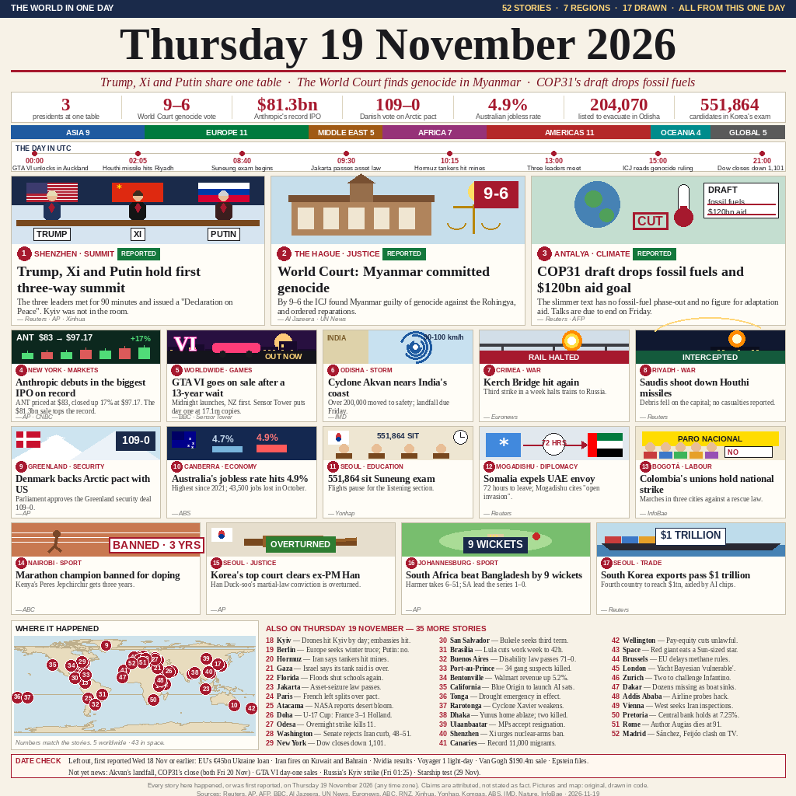

[](https://make.fun/bounty/news-image-20261119?utm_source=github&utm_medium=readme&utm_campaign=news-image-20261119)
[](https://make.fun/bounty/news-image-20261119/leaderboard?utm_source=github&utm_medium=readme&utm_campaign=news-image-20261119)
[](https://make.fun/bounty/news-image-20261119?utm_source=github&utm_medium=readme&utm_campaign=news-image-20261119)

# Thursday 19 November 2026 — the whole world on one page

One-page newspaper front page for [make.fun's "news-image-20261119" bounty](https://make.fun/bounty/news-image-20261119) ($250 in USDC): every story on it happened, or was first reported, on Thursday 19 November 2026 — in any time zone.



## What's on the page

- **52 stories, 7 regions, 17 drawn** — 3 big illustrated leads, 14 small illustrated cards, 35 one-line briefs.
- **Two quantitative visuals**: a numbers strip (3 presidents · 9–6 ICJ vote · $81.3bn IPO · 109–0 Arctic vote · 4.9% jobless · 204,070 evacuated · 551,864 exam candidates) and a **"THE DAY IN UTC" timeline** with 8 dated moments from 00:00 to 21:00 UTC.
- **Region bar** with per-region counts that sum to 52 (Asia 9, Europe 11, Middle East 5, Africa 7, Americas 11, Oceania 4, Global 5).
- **World map** with numbered pins matching the stories.
- **DATE CHECK footer**: stories deliberately left out because they belong to Wednesday 18 November or earlier, and stories that are not yet news (they break on Friday 20 November).
- **Status tags**: every illustrated story is marked REPORTED, CLAIM or FORECAST, and claims are attributed rather than stated as fact.

## The three leads

1. **Trump, Xi and Putin hold first three-way summit** — Shenzhen, 90 minutes, a "Declaration on Peace" on nuclear risk and UN reform.
2. **World Court: Myanmar committed genocide** — the ICJ finds Myanmar guilty by 9 votes to 6, the first time the court has held a state responsible.
3. **COP31 draft drops fossil fuels and $120bn aid goal** — the slimmer text has no phase-out and no adaptation-aid figure.

## Build

```sh
python3 build_newspaper.py   # renders entry.png (1024x1024, < 1 MiB)
python3 main.py              # copies entry.png to /output/entry.png
```

`build_newspaper.py` needs only Pillow plus the Liberation/DejaVu fonts shipped with most Linux systems. Every picture and the map are drawn in code — no stock photos. `land-110m.json` is a TopoJSON land outline (Natural Earth, public domain).

## Files

| file | what it is |
| --- | --- |
| `build_newspaper.py` | the whole renderer: layout, 17 illustrations, map, data |
| `entry.png` | the rendered front page (1024×1024) |
| `main.py` | stdlib-only copy of `entry.png` to `/output/entry.png` |
| `land-110m.json` | TopoJSON world land outline for the map |
| `LICENSE` | MIT |

## Sources

Reuters, AP, AFP, BBC, Al Jazeera, UN News, Euronews, ABC, RNZ, Xinhua, Yonhap, Kompas, ABS, IMD, Nature, InfoBae. Every story was checked against its publication date before inclusion.
